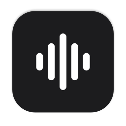

<p align="center">
  
</p>

<h1 align="center">Eco</h1>

<p align="center">Dictado por voz para macOS. Hablas, y el texto aparece donde está el cursor, limpio y con puntuación.<br>Todo se procesa en tu Mac: el audio nunca sale del computador.</p>

---

## Qué hace

- **Dictado en cualquier app.** Mantén apretada la tecla Fn, habla y suelta. El texto se pega donde está el cursor: Mail, Slack, Notas, el navegador, la terminal o lo que tengas abierto.
- **Dictado fijo.** Aprieta Fn dos veces para hablar sin mantener la tecla. Otra vez Fn para terminar, o Esc para descartar.
- **Texto limpio.** Saca muletillas ("eh", "o sea"), aplica las correcciones que haces al hablar ("el martes, no, perdón, el miércoles" queda "el miércoles") y pone comas, puntos, signos de pregunta y comillas.
- **Español e inglés.** Entiende frases que mezclan los dos idiomas.
- **Diccionario personal.** Nombres y términos que tienen que salir siempre bien escritos.
- **Aprende de tus correcciones.** Si corriges a mano una palabra mal transcrita, Eco la agrega al diccionario.
- **Historial.** Cada dictado queda guardado, con buscador y copia en un clic.
- **Reuniones.** Graba tu micrófono y el audio del Mac (Meet, Zoom, Teams o cualquier app) sin meter un bot en la llamada. Al terminar, entrega la transcripción separada en "Tú" y "Otros", y un resumen con acuerdos y tareas.
- **Sin cuentas ni suscripciones.** No hay inicio de sesión, límites de palabras ni servicios pagados.

## Requisitos

- Mac con Apple Silicon (M1 o posterior).
- macOS 26 o superior.
- Apple Intelligence activado en *Ajustes del Sistema → Apple Intelligence y Siri* (para limpiar el texto y resumir reuniones).
- Herramientas de línea de comandos de Apple con Swift 6 (`xcode-select --install`). No hace falta Xcode ni cuenta de Apple Developer.

## Instalación

```bash
git clone <url-del-repo> eco
cd eco
./scripts/build.sh --install
```

El script compila Eco, la firma con un certificado local y la deja en `~/Applications/Eco.app`. La primera compilación tarda unos minutos porque descarga las dependencias.

La primera vez que abras Eco:

1. Da los permisos de **micrófono** y **accesibilidad** desde la ventana de ajustes que se abre sola.
2. Espera a que se descargue el modelo de voz (630 MB, una sola vez). El avance se ve en *Ajustes → General*.
3. Si la tecla Fn abre los emojis, cambia en *Ajustes del Sistema → Teclado* la opción "Al presionar la tecla 🌐" a "No hacer nada".

## Uso

| Acción | Cómo |
|---|---|
| Dictar | Mantén Fn, habla y suelta |
| Dictar sin mantener la tecla | Fn dos veces; Fn otra vez para terminar |
| Descartar un dictado fijo | Esc |
| Grabar una reunión | Menú de Eco → *Grabar reunión* |
| Ver reuniones | Menú de Eco → *Reuniones…* |
| Ver dictados anteriores | Menú de Eco → *Historial de dictados…* |
| Ajustes y diccionario | Menú de Eco → *Ajustes…* |

### Ajustes

- **Atajo:** Fn, Opción derecha o Comando derecho.
- **Idioma:** español (entiende palabras en inglés), inglés o detección automática.
- **Limpieza con Apple Intelligence:** se puede apagar para pegar el texto tal como se transcribió.
- **Modelo de voz:** *Rápido* (por defecto, 630 MB) o *Preciso* (1,5 GB, se equivoca menos con palabras chilenas y nombres, pero tarda el doble).
- **Ícono:** oscuro o claro.
- **Abrir Eco al iniciar sesión.**

### Diccionario

En *Ajustes → Diccionario* se agregan palabras con la forma correcta y, separadas por coma, las formas en que suelen transcribirse mal. Por ejemplo, la palabra `Kubernetes` con las variantes `Cubernetes, Kuber netes`. Las variantes se reemplazan siempre por la palabra correcta.

## Privacidad

- El audio se transcribe en el Mac con un modelo local. No se envía a ningún servidor.
- La limpieza del texto y los resúmenes usan el modelo de Apple Intelligence que corre en el dispositivo.
- La única conexión a internet es la descarga del modelo de voz, la primera vez.
- Los datos quedan en `~/Library/Application Support/Eco`:

| Archivo o carpeta | Contenido |
|---|---|
| `Models/` | Modelos de voz descargados |
| `dictionary.json` | Diccionario personal |
| `history.json` | Historial de dictados |
| `meetings.json` y `Meetings/` | Reuniones: transcripción, resumen y audios |
| `Grabaciones/` | Los últimos 5 audios de dictado, para revisar si algo sale mal |

## Permisos

| Permiso | Para qué |
|---|---|
| Micrófono | Escuchar lo que dictas y tu voz en las reuniones |
| Accesibilidad | Detectar el atajo, pegar el texto y aprender de tus correcciones |
| Audio del sistema | Grabar lo que dicen las demás personas en una reunión (se pide la primera vez) |

## Desarrollo

- [Arquitectura y decisiones técnicas](docs/arquitectura.md)

### Compilar sin instalar

```bash
./scripts/build.sh          # deja la app en build/Eco.app
swift build -c release      # solo compila el ejecutable
```

### Pruebas por línea de comandos

El ejecutable de Eco tiene un modo sin interfaz para probar cada parte con archivos de audio o texto:

```bash
E=build/Eco.app/Contents/MacOS/Eco
$E --transcribe audio.wav es                       # transcribe y limpia un audio (es, en o auto)
$E --clean "eh hola o sea mañana"                   # prueba solo la limpieza
$E --compare audio.wav <modelo>                     # transcribe con otro modelo de voz
$E --test-learn "texto pegado" "texto corregido"    # muestra qué aprendería el diccionario
$E --summarize transcripcion.txt                    # resume una transcripción
ECO_DATA_DIR=/tmp/eco-prueba $E --test-meeting yo.wav otros.wav   # procesa una reunión completa
$E --render-bar carpeta/                            # genera imágenes de la barra flotante
$E --render-iconset carpeta.iconset dark            # genera el ícono de la app
```

`ECO_DATA_DIR` hace que Eco use otra carpeta de datos, para que las pruebas no toquen el historial ni las reuniones reales.

Para generar audios de prueba se puede usar la voz del sistema:

```bash
say -v Paulina -o prueba.wav --data-format=LEI16@16000 "Hola, nos juntamos el miércoles."
```

### Firma local

macOS asocia los permisos (micrófono, accesibilidad) a la firma de la app. Para no tener que darlos de nuevo en cada compilación, `scripts/signing.sh` crea la primera vez un certificado local (`Eco Local Signing`) en un llavero propio (`~/Library/Keychains/eco-signing.keychain-db`) y firma siempre con él. No reemplaza una firma de Apple Developer: sirve solo para este Mac.
